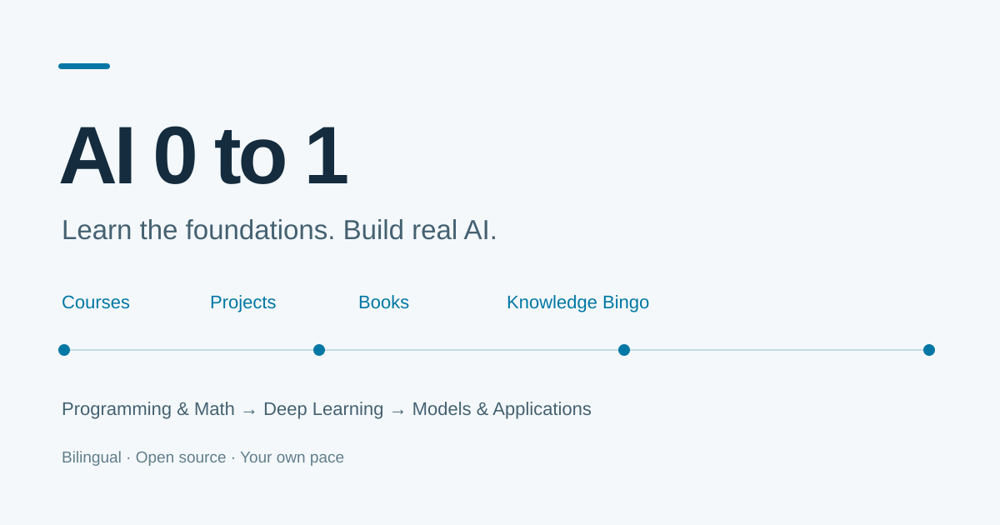

# AI 0 to 1

**A bilingual guide from AI foundations to working projects.**

[中文](README.md) · [Read online](https://leriuslei.github.io/AI-0-to-1/en/) · [Roadmap](https://leriuslei.github.io/AI-0-to-1/en/framework.html) · [Knowledge Bingo](https://leriuslei.github.io/AI-0-to-1/en/knowledge/index.html)



AI resources are plentiful. Knowing what to study first, which courses overlap and what to build next is harder. This guide connects public courses, books and open-source projects, explaining their audience, content and role in a learning path.

## The path

**Python and tools → mathematics → machine learning and deep learning → small model implementations → a specialization and a project.**

Shared implementation path: **PyTorch → micrograd → makemore → tiny GPT → Stanford CS336 Assignment 1**.

Specializations cover pretraining, synthetic data, SFT/LoRA, DPO/GRPO, RAG, agents, evaluation, inference engines, distributed training, vision, diffusion, reinforcement learning, JEPA, world models and robotics/VLA.

## What's inside

- **Courses:** university courses, official tutorials and Datawhale, with prerequisites, difficulty, audience and source links.
- **Projects:** comparisons of purpose, design, setup and suggested use.
- **Books:** references for mathematics, derivations and implementations.
- **Knowledge Bingo:** 345 terms across 16 topics, with examples, common confusions, related concepts and six numeric interactions.
- **AI & Business:** Karpathy, Mollick, Sutton, Chip Huyen, Kevin Kelly, and official OpenAI and Anthropic research.
- **Two languages and search:** switching preserves the current page; search also finds glossary terms. External materials retain their authors' languages.

The catalog contains **53 course entries, 62 projects and 13 technical books**. CS239A remains an unidentified course code. AI & Business adds 11 readings. Counts and GitHub stars are editorial snapshots; consult original sites for updates.

Reading marks stay in your browser and can be imported or exported. No account, progress uploads or built-in analytics are required.

## Run locally

Use Python 3.10+ from the repository root:

```bash
python -m venv .venv
source .venv/bin/activate
# Windows PowerShell: .venv\Scripts\Activate.ps1
python -m pip install -r requirements.txt
python scripts/render_docs.py
python scripts/build.py
python -m http.server 8000 --directory site
```

Open [http://localhost:8000/en/](http://localhost:8000/en/). Built HTML also supports direct file opening and offline search.

## Edit and contribute

Edit `data/catalog.json` for resources; `data/knowledge_seed.json` and `scripts/bingo_*.py` for the glossary; `scripts/render_bilingual.py`, `scripts/site_pages.py` and `scripts/business_pages.py` for site content; `web/` and `overrides/` for the interface. Generated docs, config files and `site/` are ignored.

After building, run:

```bash
python scripts/verify_bilingual.py
python scripts/verify_bingo.py
python scripts/verify_public.py
```

See [CONTRIBUTING.md](CONTRIBUTING.md). Report broken links and terminology issues through [Issues](https://github.com/LeriusLei/AI-0-to-1/issues), or submit a PR. A [GitHub Star](https://github.com/LeriusLei/AI-0-to-1) helps others find the guide.

## Deployment and discovery

Choose **GitHub Actions** as the Pages source, then push to `main` or run **Deploy AI 0 to 1**. The workflow builds both languages and deploys pushes to `main`.

The site includes descriptive metadata, canonical URLs, language alternates, structured data, robots instructions and a bilingual sitemap. Search engines determine indexing and ranking. See [DEPLOYMENT.md](DEPLOYMENT.md).

## License and acknowledgments

This project retains the repository's [GPL-3.0 license](LICENSE). Linked courses, books, papers, code and trademarks retain their respective owners and licenses. Textbooks, datasets and model weights are not bundled.

Built with MkDocs Material; documentation organization inspired by [CSStudyGuide](https://github.com/ZH1995/CSStudyGuide/). See [THIRD_PARTY.md](THIRD_PARTY.md) for component notices.
