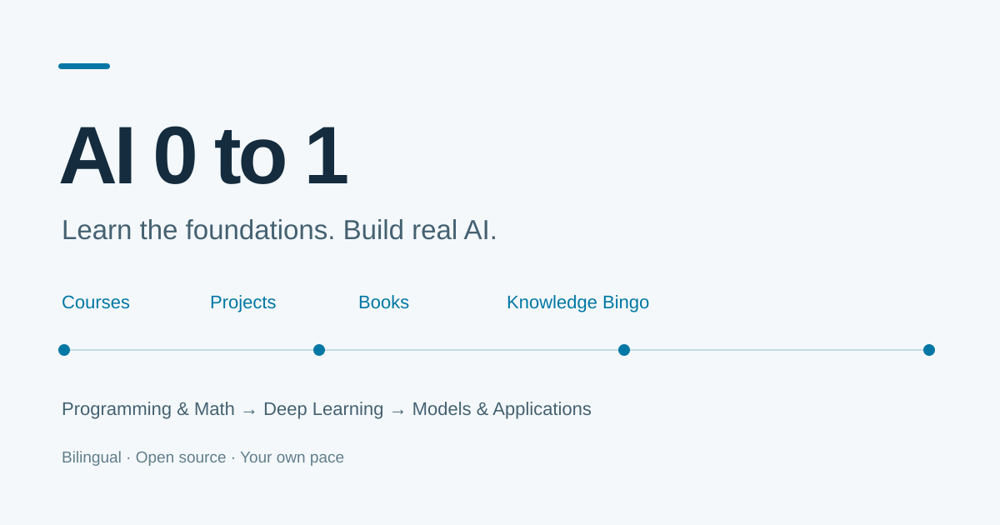

# AI 0 to 1

**从基础到 AI 项目的双语自学指南。**

[English](README.en.md) · [在线阅读](https://leriuslei.github.io/AI-0-to-1/) · [学习路线](https://leriuslei.github.io/AI-0-to-1/framework.html) · [知识 Bingo](https://leriuslei.github.io/AI-0-to-1/knowledge/index.html)



学 AI 的资料很多，难的是知道先学什么、哪些课程重复、学完以后做什么。AI 0 to 1 把公开课程、教材和开源项目放进一条学习路线，并说明各自适合谁、讲什么、怎样衔接。

## 学习路线

**Python 与工具 → 数学 → 机器学习与深度学习 → 小模型实现 → 选择方向做项目。**

共同的代码练习线：**PyTorch → micrograd → makemore → tiny GPT → Stanford CS336 Assignment 1**。

| 方向 | 内容举例 |
| --- | --- |
| 模型训练 | 预训练、数据处理与合成、SFT、LoRA、DPO、GRPO |
| AI 应用 | RAG、Agent、工具调用、评测与部署 |
| AI 系统 | 推理引擎、KV Cache、调度、分布式训练 |
| 生成与多模态 | 计算机视觉、扩散模型、视觉语言模型 |
| 决策与具身 | 强化学习、JEPA、世界模型、VLA 与机器人 |

## 网站里有什么

- **课程推荐**：大学公开课、官方教程与 Datawhale。33 个条目附 B 站入口，标明年份、字幕及是否为部分讲解。
- **开源项目**：按“想学什么 → 选哪个 → 能做什么”比较用途和区别，区分合成数据、数据处理与推理系统。
- **书目推荐**：按阶段补数学、推导和代码参考。
- **AI 知识 Bingo**：345 个术语、16 个主题，含例子、易混点、相关概念和 6 种数值交互。
- **AI 商业认知**：Karpathy、Mollick、Sutton、Chip Huyen、Kevin Kelly，以及 OpenAI / Anthropic 官方研究。
- **中英切换与搜索**：同一页面切换语言；站内搜索也能直接找到术语。外部资料保持原作者的语言。

当前目录含 **51 个课程条目、62 个项目、13 本技术书**。商业认知栏目另收录 11 项阅读资料。数量和项目 Star 是编辑快照，更新以原站为准。

阅读圆圈的勾选记录只保存在自己的浏览器里，可导入、导出备份。网站不需要账号，不上传阅读进度，也不内置访问统计。

## 本地运行

需要 Python 3.10 或更新版本。在仓库根目录执行：

```bash
python -m venv .venv
# macOS / Linux
source .venv/bin/activate
# Windows PowerShell 使用：.venv\Scripts\Activate.ps1
python -m pip install -r requirements.txt
python scripts/render_docs.py
python scripts/build.py
python -m http.server 8000 --directory site
```

打开 [http://localhost:8000](http://localhost:8000)。构建后的 `site/index.html` 也支持直接打开及离线搜索；英文在 `site/en/index.html`。

## 修改与贡献

| 位置 | 用途 |
| --- | --- |
| `data/catalog.json` | 课程、项目、书籍与双语条目 |
| `data/bilibili_resources.json` | B 站视频、字幕、版本与对应范围 |
| `scripts/navigation_content.py` | 学习目标、起点与项目实践结果 |
| `data/knowledge_seed.json`、`scripts/bingo_*.py` | 术语内容、补充和英文讲解 |
| `data/framework_sources.json` | 学习框架参考来源 |
| `scripts/render_bilingual.py`、`scripts/site_pages.py` | 导航、路线与工具说明 |
| `scripts/business_pages.py` | AI 商业认知阅读资料 |
| `web/`、`overrides/` | Bingo 界面与站点模板 |

`docs/`、`docs_en/`、`site/` 和 MkDocs 配置由脚本生成，不提交构建结果。更新后运行：

```bash
python scripts/verify_bilingual.py
python scripts/verify_bingo.py
python scripts/verify_learning.py
python scripts/verify_public.py
```

欢迎通过 [Issue](https://github.com/LeriusLei/AI-0-to-1/issues) 反馈失效链接、术语问题或课程建议，也欢迎提交 PR。具体见 [贡献指南](CONTRIBUTING.md)。如果这个指南对你有用，可以在 [GitHub](https://github.com/LeriusLei/AI-0-to-1) 点一个 Star。

## 部署与搜索收录

GitHub Pages 使用 `.github/workflows/pages.yml` 构建和部署；仓库设置中的 **Pages → Source** 选择 **GitHub Actions**。推送到 `main` 后自动更新网站。

站点包含标题、描述、规范地址、语言对应链接、结构化数据、`robots.txt` 和双语 `sitemap.xml`。搜索引擎收录和排名由其自行决定；维护者可用 Search Console 提交站点地图，详见 [部署说明](DEPLOYMENT.md)。

## 许可与致谢

网站使用 MkDocs Material；文档组织参考 [CSStudyGuide](https://github.com/ZH1995/CSStudyGuide/)。第三方组件许可见 [THIRD_PARTY.md](THIRD_PARTY.md)。
